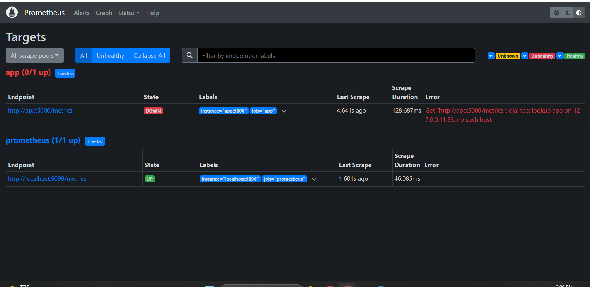
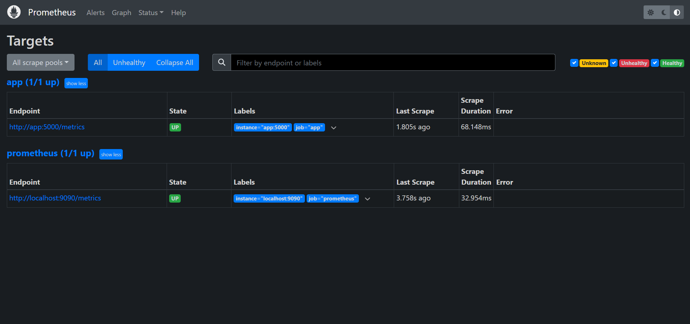
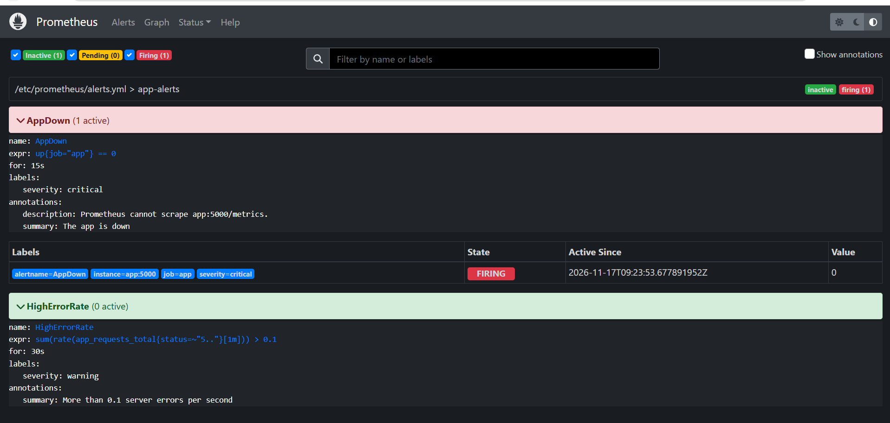
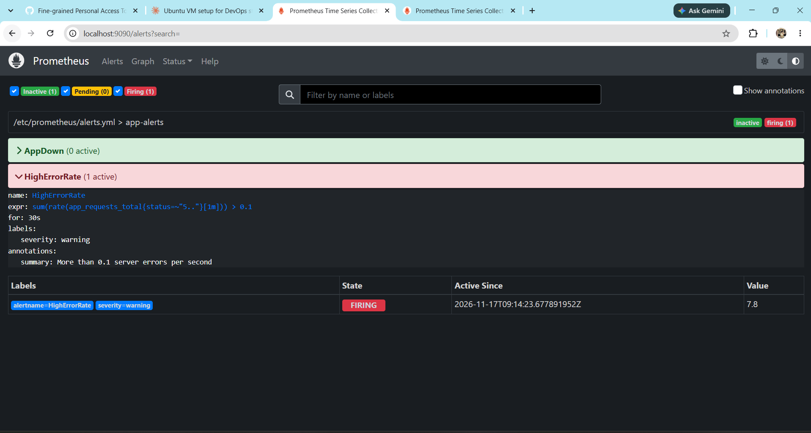
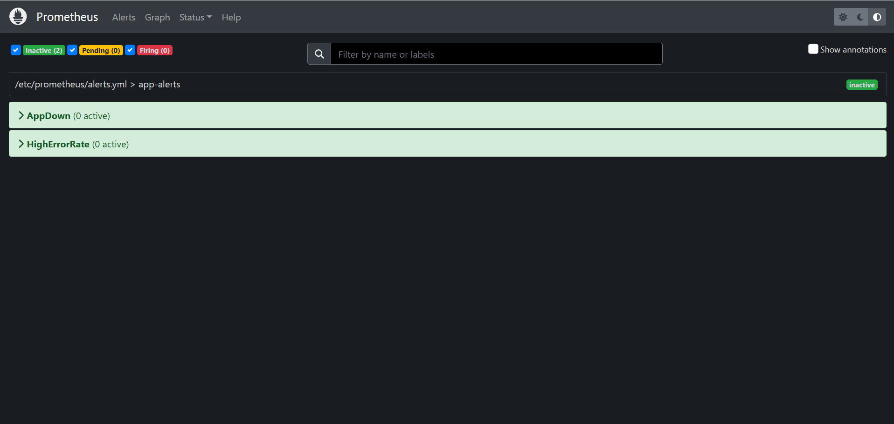

# DevOps Automation Stack

A small Flask API deployed to an Ubuntu environment with one Ansible command. Ansible configures the server, Docker Compose runs the app and its observability stack, and a GitLab CI pipeline tests, builds and scans the image.

> Everything runs locally and costs nothing. No cloud account is needed.

## What it demonstrates

| Area | Tool |
|---|---|
| Server configuration (idempotent) | Ansible roles: `common`, `docker`, `nginx`, `stack` |
| Reverse proxy and firewall | Nginx, UFW |
| Containers | Docker, Docker Compose |
| Metrics and alerting | Prometheus (alert rules `AppDown`, `HighErrorRate`) and Grafana |
| Centralised logs | Loki and Promtail, searched in Grafana |
| CI | GitLab CI: pytest, Ansible syntax check, image build, Trivy scan |

## Architecture

```
Browser -> Nginx (:80) -> app container (:5000)
                            |-- /metrics ----> Prometheus -> alerts
                            '-- stdout logs -> Promtail -> Loki
                                             Grafana reads both
```

## Run it

Tested on Ubuntu (WSL2) with Docker. It also works on a normal Ubuntu VM, or with Vagrant and VirtualBox.

**Option 1: Ubuntu (VM or WSL)**

```bash
git clone https://github.com/kabindrashah/devops-automation-stack.git
cd devops-automation-stack/ansible
sudo apt update && sudo apt install -y ansible
ansible-playbook -i localhost, -c local site.yml -e project_root=$(dirname $PWD) -K
```

**Option 2: Vagrant (VirtualBox)**

```bash
vagrant up
```

| What | URL |
|---|---|
| App (through Nginx) | http://localhost |
| Health check | http://localhost/health |
| Prometheus and alerts | http://localhost:9090/alerts |
| Grafana (admin / admin, change it) | http://localhost:3000 |

With Vagrant, the app is on port 8080 instead of 80.

Run the tests without the VM:

```bash
pip install -r app/requirements-dev.txt
pytest app -v
```

## Idempotency

Running the playbook a second time should change almost nothing. That shows the playbook describes a state and does not blindly repeat commands.

## Failure test

1. Open http://localhost:9090/alerts and confirm both alerts are green.
2. Stop the app: `docker stop app`.
3. After about 20 seconds, `AppDown` turns Firing in Prometheus.
4. In Grafana, go to Explore, choose Loki, and run `{container="app"}` to see the app's last logs.
5. Restart it: `docker start app`, and watch the alert clear.
6. For the error alert, send errors with `for i in $(seq 1 100); do curl -s localhost/boom > /dev/null; done` and watch `HighErrorRate`.

### Results

Prometheus targets, with the app down and then recovered:




`AppDown` firing after I stopped the app container:



`HighErrorRate` firing during the error spike (7.8 errors per second against a 0.1 threshold):



Both alerts back to normal after recovery:



More notes are in [docs/failure-test.md](docs/failure-test.md).

## What I learned

- The `for:` clause stops brief blips from firing alerts.
- An alert based on `rate()` clears by itself when traffic stops, so "no errors" can mean "no traffic". That is why `AppDown` exists too.
- Metrics tell me that something broke, and logs in Loki tell me why.

## Next improvements

- Add Alertmanager and send alerts to Telegram or email.
- Add a Grafana dashboard for request rate, error rate and latency.
- Create the server with Terraform, or apply the same playbook to a cloud server.
- Add Ansible Vault for the Grafana admin password.

## Security notes

- Ports 3000 and 9090 are open for the lab only. Do not expose them on a real server.
- Change the default Grafana password. Never commit `.env` files, keys or real IP addresses.
- The firewall (UFW) allows only SSH, HTTP, Grafana and Prometheus.
